# Phishing Detector on AWS

A phishing detector for email files, with a simple web UI, deployed on AWS with Terraform.
Every scan is stored in PostgreSQL, and the environment is fully monitored with CloudWatch.

Built as a home assignment for the Cloud Monitoring Engineer (student) role at Upwind.

- **Part 1:** a Python detector that scores an email for common phishing indicators, with a CLI and a Flask web UI.
- **Part 2:** the same app running on two EC2 instances behind an Application Load Balancer, with RDS, created by Terraform and observable through a CloudWatch dashboard, alarms and logs.
- **Bonus:** an ElastiCache (Redis) cache for the sender-history lookup, and CI with GitHub Actions.

---

## Architecture

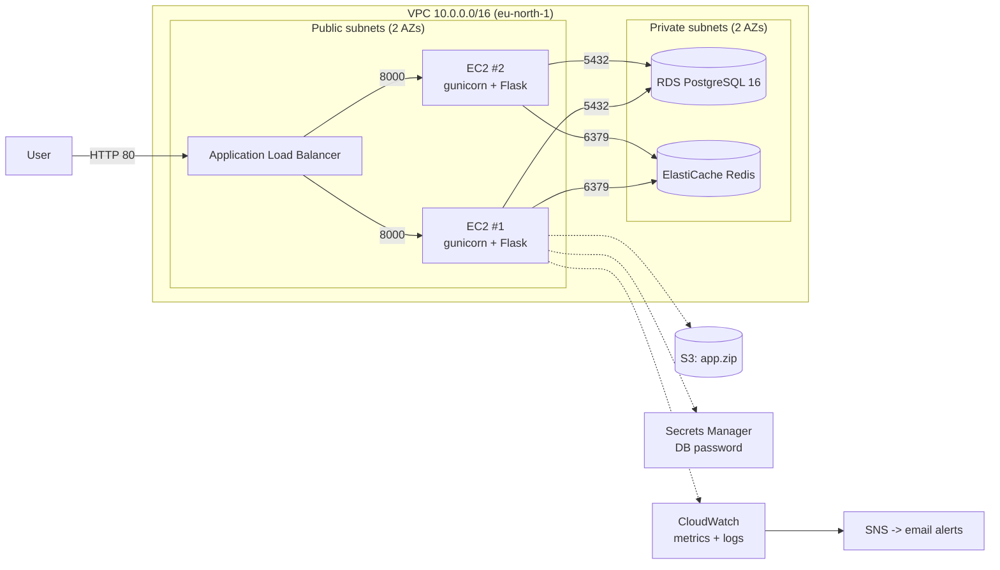

**Request path:** the browser reaches the ALB, which forwards to a healthy instance on port 8000.
The instance runs `scan_email`, saves the result in RDS and returns the result page.

**Security group chain:** internet -> ALB (80) -> app servers (8000, only from the ALB SG) -> RDS (5432) and ElastiCache (6379), both only from the app SG.
The database and the cache have no public address and no outbound rules.

---

## Repository layout

```
detector.py          Detection logic and CLI (scan_email)
app.py               Flask web UI: /, /scan, /history, /health
db.py                PostgreSQL access (psycopg 3), config from environment variables
cache.py             Redis cache-aside for sender history, with graceful fallback
templates/           Jinja templates (base, index, result, history)
test_detector.py     Unit tests for the detection logic
test_app.py          Web tests with an in-memory FakeDB (no PostgreSQL needed)
sample_*.txt/.eml    Sample emails (phishing, safe, newsletter, attachment)
requirements.txt     Pinned runtime dependencies
.github/workflows/   CI: tests, terraform fmt and validate on every push
docs/screenshots/    Screenshots from a full run
infra/               Terraform for the AWS environment
```

```
infra/
  providers.tf        AWS provider, region, default tags
  network.tf          VPC, 2 public + 2 private subnets, internet gateway, route table
  security.tf         Security groups: alb -> app -> db
  database.tf         RDS subnet group and PostgreSQL instance (AWS-managed password)
  iam.tf              Instance role: SSM, CloudWatch agent, read one secret, read the code bucket
  s3.tf               Code bucket and the app.zip object
  user_data.sh.tftpl  Instance bootstrap script (template)
  servers.tf          Launch template (IMDSv2) and Auto Scaling Group with instance refresh
  alb.tf              Load balancer, target group (/health), listener
  monitoring.tf       CloudWatch dashboard and log group
  alerts.tf           SNS topic, email subscription, alarms
  cache.tf            ElastiCache subnet group, Redis cluster, cache_address output
  outputs.tf          app_url, db_address, db_secret_arn
```

---

## Part 1: the detector

### Indicators

| Indicator | What is checked | Points |
| --- | --- | --- |
| Suspicious links | IP-address links, brand names on unrelated domains, uncommon TLDs (`.xyz`, `.top`, `.click`, `.zip`) | 25 per reason |
| Spoofed sender | Lookalike domains (`paypa1` -> `paypal`), brand in the display name with a different domain | 30 once |
| Suspicious wording | Urgency, threats, credential requests, money, generic greetings | 10 per category |
| Attachments | Dangerous extensions, double extensions (`invoice.pdf.exe`), macro documents, archives | 30 per reason |
| History of actions | The sender was flagged as phishing in earlier scans | 30 |

The score is capped at 100. **High** is 60 and above (reported as phishing), **medium** is 30-59, **low** is below 30.

Two scoring decisions worth knowing:
- A suspicious sender counts once, even with two reasons, so a legitimate newsletter is not pushed to high by the sender alone.
- History counts only **high** scans. Counting medium scans created a feedback loop where an email became high just because it was scanned before.

### Run locally

Requires Python 3.12 and Docker.

```powershell
python -m venv .venv
.\.venv\Scripts\Activate.ps1
pip install -r requirements.txt pytest

# PostgreSQL for the web app
docker run --name pg -e POSTGRES_USER=phish -e POSTGRES_PASSWORD=localdev -e POSTGRES_DB=phishing -p 5432:5432 -d postgres:16
$env:DB_PASSWORD = "localdev"
```

Any PostgreSQL 16 works instead of Docker: create a user `phish` and a database `phishing`, and set the `DB_*` variables.

```powershell
# CLI
python detector.py sample_email.txt

# Web UI on http://localhost:8000
python app.py

# Tests (no database needed)
python -m pytest -q
```

Database settings come from `DB_HOST`, `DB_PORT`, `DB_NAME`, `DB_USER` and `DB_PASSWORD`.
Only `DB_PASSWORD` is required; the others default to `localhost`, `5432`, `phishing` and `phish`.
`REDIS_HOST` is optional: without it the app runs without a cache and reads history straight from PostgreSQL.

If the database is down, scanning still works: the result page shows that the scan was not saved, and `/history` returns 503.

---

## Part 2: AWS deployment

### Prerequisites

- Terraform 1.5 or later and AWS CLI 2.35 or later
- An AWS account (created with the new sign-up experience, Free plan)
- `infra/terraform.tfvars` (not committed) with the email that receives alerts:
  ```hcl
  alert_email = "you@example.com"
  ```

### Deploy

```powershell
# 1. Sign in (opens a browser; choose the project session)
aws login --region eu-north-1 --profile phishing
aws sts get-caller-identity --profile phishing

# 2. Package the committed code
git archive --format=zip --output=infra/app.zip HEAD

# 3. Plan and apply
cd infra
aws configure export-credentials --profile phishing --format powershell | Invoke-Expression
terraform init
terraform plan -out=tfplan
terraform apply tfplan
```

The apply takes about 15 minutes (RDS is the slowest part). After it finishes:
- Wait 3-5 minutes for the instances to bootstrap, then open the `app_url` output.
- Confirm the SNS subscription email, or alarms will not be delivered. A new confirmation is sent after every destroy and apply.

### Deploying during a demo

RDS and ElastiCache take about 7-8 minutes to create, so they are created in advance (the assignment allows this for RDS), and everything else is deployed live in about 2.5 minutes:

```powershell
# Before the demo (quotes are required in PowerShell)
terraform plan "-target=aws_db_instance.main" "-target=aws_elasticache_cluster.main" -out=tfplan
terraform apply tfplan

# During the demo
terraform plan -out=tfplan
terraform apply tfplan
```

The ALB address changes on every deployment; always take it from `terraform output -raw app_url`.

### Deploying code changes

Commit, rebuild the zip, and apply. The zip's `etag` is part of the launch template, so a code change creates a new template version and triggers a rolling **instance refresh**: one instance at a time, keeping at least one healthy, so the site stays up.

```powershell
git archive --format=zip --output=infra/app.zip HEAD
cd infra
terraform plan -out=tfplan
terraform apply tfplan
```

### Instance bootstrap

`user_data.sh.tftpl` runs once on every new instance:
1. Installs Python 3.12 and the CloudWatch agent.
2. Downloads `app.zip` from S3 using the instance role.
3. Creates a venv and installs `requirements.txt`.
4. Reads the database password from Secrets Manager and writes `/etc/phishing.env` (mode 600, readable only by root; systemd loads it before dropping privileges), including `REDIS_HOST`.
5. Runs the app with gunicorn (2 workers) as a systemd service with `Restart=always`, as an unprivileged `phishing` user.
6. Starts the CloudWatch agent for memory, disk and the application log.

---

## Monitoring

Everything is on one CloudWatch dashboard, `phishing-detector`.

| Question from the assignment | Where to look |
| --- | --- |
| Are the EC2 instances healthy? | `HealthyHostCount` / `UnHealthyHostCount` of the target group |
| How much CPU and system resources? | `CPUUtilization`; memory and disk from the CloudWatch agent (`PhishingDetector` namespace) |
| How many requests reach the load balancer? | `RequestCount` |
| Are requests succeeding or failing? | `HTTPCode_Target_2XX/4XX/5XX_Count` and `HTTPCode_ELB_5XX_Count` |
| Where are the application logs? | CloudWatch Logs, log group `/phishing/app`, one stream per instance; latest lines on the dashboard |

Response time is shown as average and **p95**, because an average hides the slow requests users actually notice.
`Target_5XX` means the app returned an error; `ELB_5XX` means the load balancer found no healthy target.

### Alarms (email through SNS)

| Alarm | Condition | Missing data |
| --- | --- | --- |
| `phishing-healthy-hosts-low` | Fewer than 2 healthy hosts for 1 minute | breaching |
| `phishing-app-5xx` | 5 or more app 5XX responses in 5 minutes | not breaching |
| `phishing-alb-5xx` | Any ALB 5XX in 5 minutes | not breaching |
| `phishing-cpu-high` | Average CPU above 80% for 5 minutes | not breaching |

The ALB publishes no 5XX datapoint in a minute without errors, so missing data is treated as healthy there.
`HealthyHostCount` is always published, so if it disappears, that is treated as a problem.

### Finding one server that lost the database

`/health` deliberately does not check the database. If it did, a database outage would mark every instance unhealthy, the ALB would stop sending traffic, and the ASG would keep replacing instances that fail the same way (a cascading failure).
Instead, every scan logs `saved=True/False`, and the dashboard counts `saved=False` per log stream. A single server losing the database shows up as one stream with a rising count.

---

## Caching (bonus: ElastiCache)

Every scan asks "how many times was this sender flagged before?". That lookup now uses **cache-aside** with Redis on ElastiCache:

1. Read `history:<sender>` from Redis. A hit returns immediately.
2. On a miss, query PostgreSQL and store the result for 5 minutes (TTL).
3. When a phishing scan is saved, delete that sender's key, because the count changed (invalidation).

Design choices:
- **The cache can never break a scan.** Redis calls time out after 0.5 seconds, and any cache error falls back to PostgreSQL. RDS is the source of truth; the cache is a copy that rebuilds itself.
- **Single node, no replication.** Losing the cache loses no data, only speed for a few minutes (a cold cache).
- **Shared by both instances,** so a value cached by one server is a hit on the other.
- **Trade-off:** invalidation runs on every phishing scan, so repeat phishing senders always miss. The cache mostly saves queries for legitimate senders, which are most traffic. Incrementing the cached value instead of deleting it would avoid that, at the cost of harder correctness under concurrent writes.

The dashboard shows `CacheHits` and `CacheMisses`. Scanning a safe email three times gives one miss and two hits.

---

## CI

GitHub Actions (`.github/workflows/ci.yml`) runs on every push to `main` and on pull requests:
- **python:** installs `requirements.txt` and runs the tests (no database needed, thanks to the in-memory FakeDB).
- **terraform:** builds `app.zip` with `git archive` (required by `filemd5`), then `terraform fmt -check`, `init -backend=false` and `validate`.

CI has no AWS credentials and does not run `plan`: the state is local, and long-lived AWS keys in GitHub were avoided on purpose. A team setup would keep state in S3 and give CI a read-only role through GitHub OIDC, so every pull request gets a plan.

---

## Security and reliability decisions

- **No secrets in code, Git or Terraform state.** RDS uses `manage_master_user_password`, so AWS generates and stores the password in Secrets Manager. Instances read it at boot.
- **Least privilege.** The instance role can read one secret and get objects from one bucket, plus the AWS-managed policies for SSM and the CloudWatch agent.
- **No SSH.** Instances are reached through SSM Session Manager; port 22 is closed.
- **IMDSv2 required**, which blocks SSRF-style theft of instance credentials.
- **Private database** in private subnets, reachable only from the app security group.
- **Temporary credentials only** on the workstation (`aws login`), no long-term access keys.
- **Self-healing.** The ASG keeps two instances across two AZs and replaces any instance that fails the ALB health check. Tested by terminating an instance: the site stayed up with no 5XX errors, the ALARM email arrived about 4 minutes later, and the OK email 2 minutes after that, once the replacement was healthy.
- **Graceful degradation.** Scans keep working when the database is unavailable.
- **Unprivileged app process.** gunicorn runs as a `phishing` system user with no login shell, not as root. It can read the code but not change it, and cannot read the secrets file.
- **Safe concurrent startup.** Both instances create the schema at boot; a PostgreSQL advisory lock (`pg_advisory_xact_lock`) serializes it, so they no longer race on `CREATE TABLE IF NOT EXISTS`.
- **No NAT gateway.** Instances live in public subnets with public IPs but accept traffic only from the ALB. This saves about $33 per month.

---

## Cost and teardown

The running environment costs roughly $2.50 per day (ALB, two `t3.micro`, `db.t4g.micro`, `cache.t3.micro`, public IPv4 addresses). It is destroyed at the end of every work session.

```powershell
cd infra
aws configure export-credentials --profile phishing --format powershell | Invoke-Expression
terraform destroy
terraform state list   # expected: no output
```

Verify in AWS itself that nothing tagged with the project is left:

```powershell
# Anything that is not an instance (expected: [])
aws resourcegroupstaggingapi get-resources --tag-filters Key=Project,Values=phishing-detector --profile phishing --no-cli-pager --query "ResourceTagMappingList[?!contains(ResourceARN, ':instance/')].ResourceARN"

# Instances that still exist (expected: [])
aws ec2 describe-instances --filters "Name=tag:Project,Values=phishing-detector" "Name=instance-state-name,Values=pending,running,stopping,stopped" --profile phishing --no-cli-pager --query "Reservations[].Instances[].InstanceId"
```

Terminated instances remain visible to the tagging API for about an hour; that is expected.

---

## Notes from deployment

- **Region.** Projects in the new AWS sign-up experience have a home region. A service control policy denied EC2 and S3 actions in every other region (`ec2:CreateVpc`, `s3:CreateBucket`) while IAM, a global service, worked. The cause was found with the authorization ID in the error (`aws iam-toolbox get-request-authorization-details`) and confirmed with `aws ec2 create-vpc --dry-run` per region. The environment runs in `eu-north-1`.
- **Alarm tuning.** The healthy-hosts alarm first required 2 consecutive minutes below 2. In one test the replacement instance became healthy in under 2 minutes, so the alarm never fired, which the alarm history and graph confirmed. With only two servers, losing one is half the capacity, so the alarm now fires after 1 minute. CloudWatch metrics still arrive a few minutes late, so the email comes a few minutes after the event.
- **First Auto Scaling Group in the account.** The first launch failed with access denied on `AWSServiceRoleForAutoScaling`, because the service-linked role was created at that moment and had not propagated yet. The ASG succeeded on its own retry, and the Terraform state was fixed with `terraform untaint`.

---

## Screenshots

All screenshots are from a full run on November 8, 2026. The environment was destroyed afterwards.

### The app in AWS

Scan result for `sample_email.txt`:

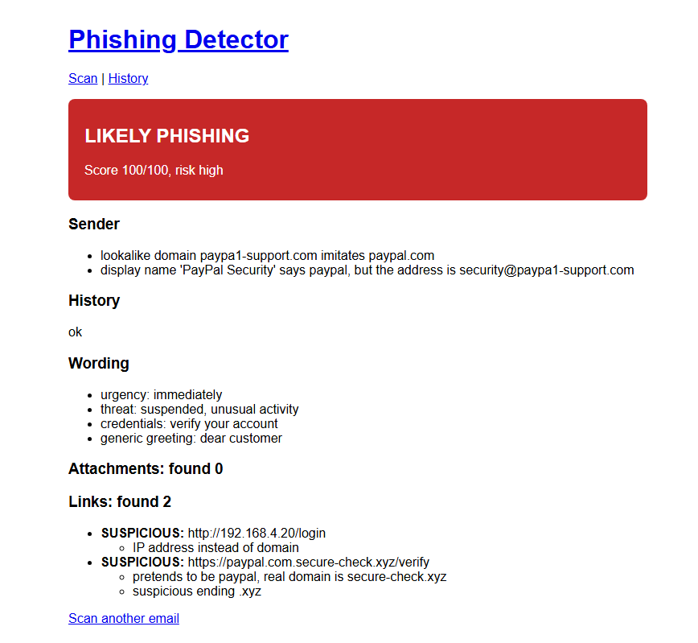

The same email scanned again. The History of Actions indicator comes from RDS:

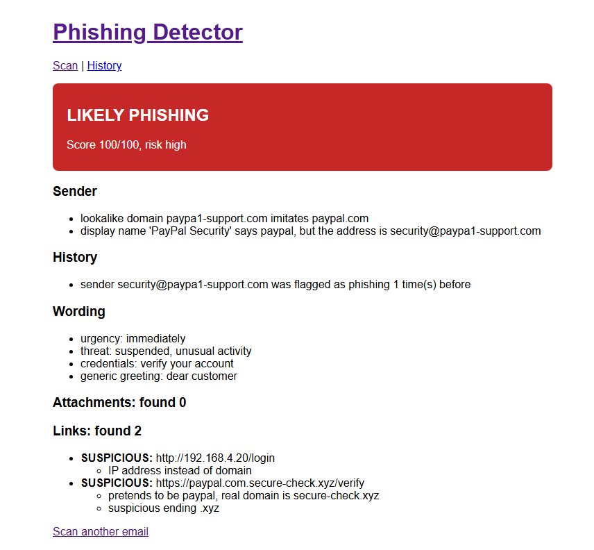

The `/history` page, read from RDS:

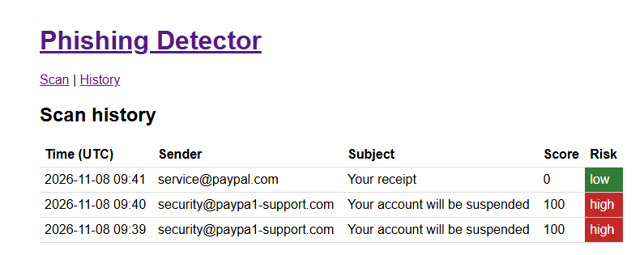

### Deployment

`terraform apply` output. RDS was created in advance with `-target`, as the assignment allows; this apply created everything else:

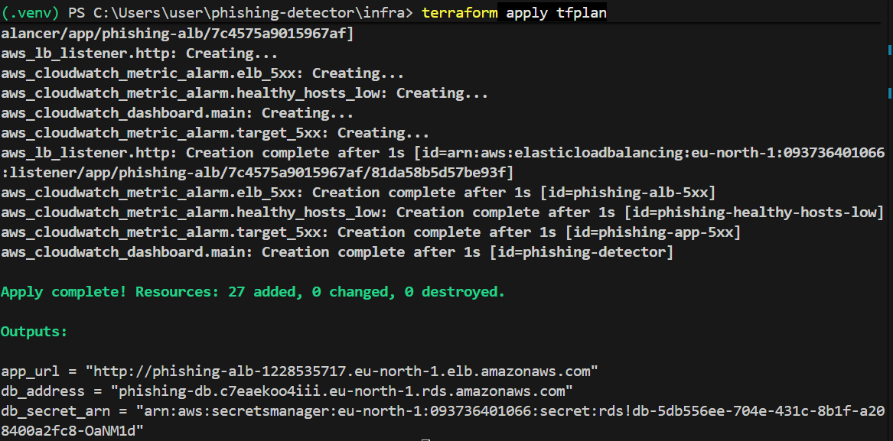

Both instances healthy in the target group, one in each Availability Zone:

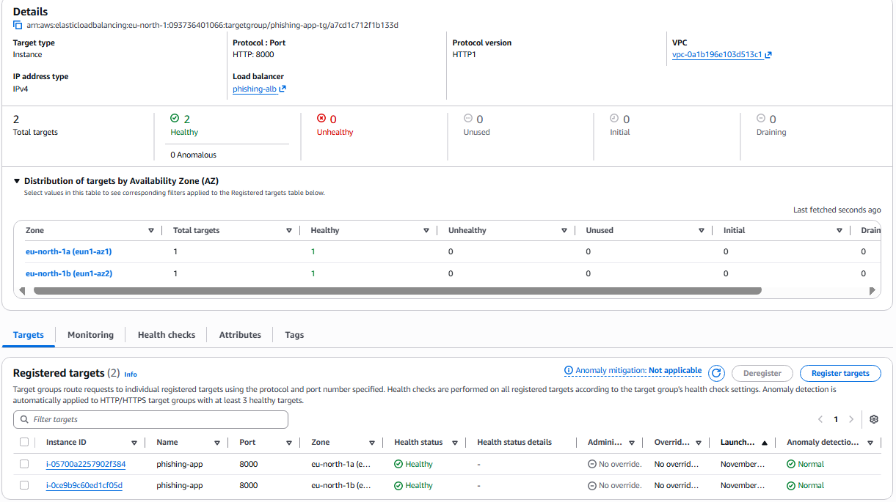

### Monitoring

The CloudWatch dashboard: health, requests, success vs failure, response time, CPU, memory and disk, and application logs:

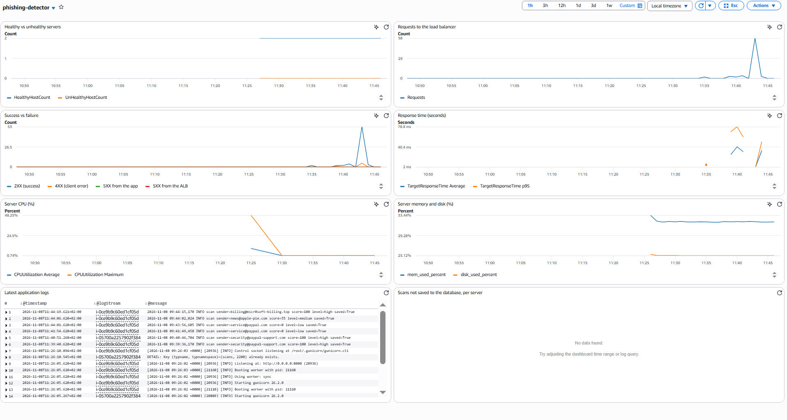

Application logs in CloudWatch Logs, one stream per instance:

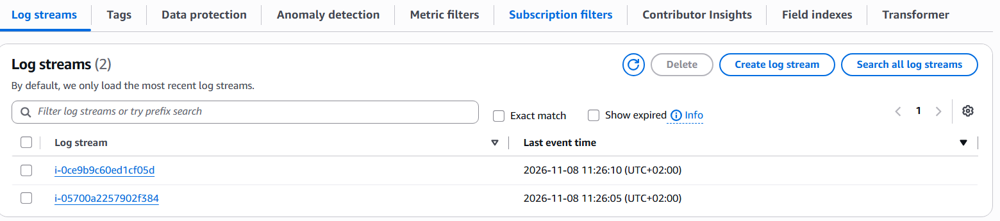

### Self-healing

After terminating one instance: healthy hosts dropped to 1 and returned to 2, with no 5XX errors:

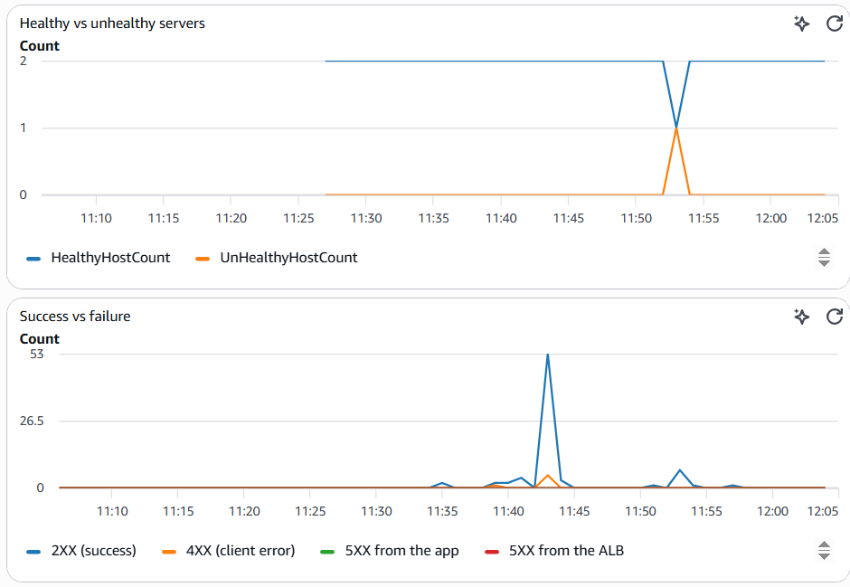

The ALARM and OK emails for the same event:

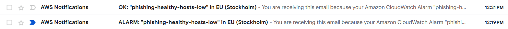

### Hardening and caching

Both instances log their gunicorn control socket under `/var/lib/phishing`, so gunicorn runs as the unprivileged user; a search for `already exists` returns nothing, so the schema lock works:

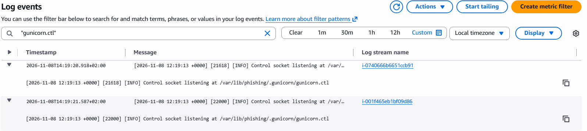

Cache hits and misses after scanning a safe email three times and a phishing email twice:

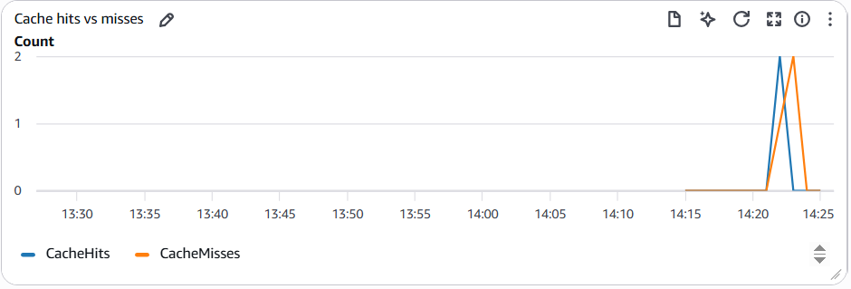

### CI

Both CI jobs passing on GitHub Actions:

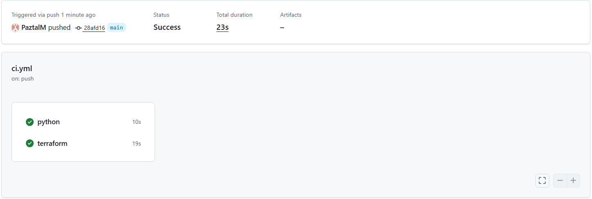

### Teardown

`terraform destroy` and the checks in AWS that nothing is left:

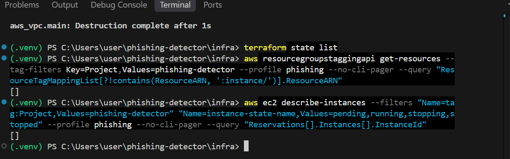

---

## Known limitations and next steps

- HTTP only. In production, an ACM certificate on the ALB and HTTPS.
- Single-AZ RDS. Multi-AZ gives automatic failover at about twice the cost.
- The managed DB password rotates every 7 days, but the app reads it only at boot. The app should re-read the secret when a connection fails.
- A new database connection per request. A connection pool (`psycopg_pool`) for higher traffic.
- No schema migrations (for example Alembic).
- History counts by exact sender address. Counting by domain would catch attackers who rotate addresses.
- Building and uploading `app.zip` is manual. A CI pipeline (GitHub Actions) would test, package and deploy on every push.
- Terraform state is local. A team would use a remote backend (S3 with locking).
- The Redis cache has no AUTH token and no in-transit encryption; it relies on the private subnet and its security group. Production would enable both.
- Bonus item not implemented: a Gmail add-on. It would need an HTTPS JSON API and is a separate product, so the infrastructure-related bonus (ElastiCache) was chosen.